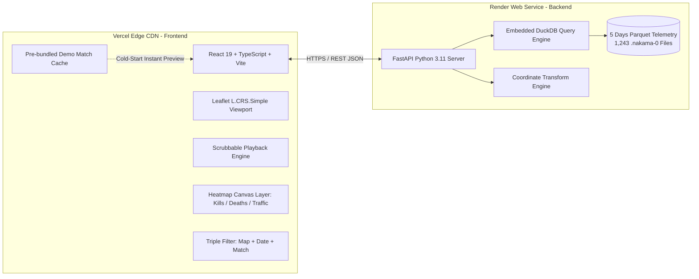

# LILA BLACK — Player Journey Visualization Tool: Implementation Guide

> **Architecture:** Decoupled Hybrid Cloud (**Frontend on Vercel** + **Backend on Render**)  
> **Target Audience:** Engineering Team & Level Designers at LILA Games  
> **Companion Document:** [ARCHITECTURE.md](file:///e:/PM_Portfolio_Projects/Lila-Games-/Docs/architecture.md)

---

## 1. System Architecture & Core Requirements Mapping

In accordance with our [ARCHITECTURE.md](file:///e:/PM_Portfolio_Projects/Lila-Games-/Docs/architecture.md) and the LILA Games Written Test specification, the tool fulfills all 8 Core Requirements through a decoupled, high-performance web architecture:

| # | Core Written Test Requirement | Architectural Implementation Mechanism |
|---|---|---|
| **1** | **Load & parse Parquet data** | Embedded **DuckDB** in Python 3.11 scans 1,243 `.nakama-0` files directly on disk via columnar pushdown without memory bottlenecks. |
| **2** | **Minimap projection & coordinates** | Mathematical transformation engine projects world $(x, z) \to$ minimap pixels $(px, py)$ on $1024 \times 1024$ raster maps with inverted Y-axis. |
| **3** | **Distinguish humans vs. bots** | Regex identification: UUID = Human (solid cyan paths), numeric ID = Bot (dashed amber paths at 50% opacity). |
| **4** | **Distinct event markers** | Visual marker layer for all 4 categories: Kills (Red Skull), Deaths (Crimson Cross), Storm Deaths (Purple Cloud), Loot (Emerald Diamond). |
| **5** | **Filter by map, date, and match** | Triple-tier reactive filter bar: Date selector (`February_10` to `February_14`), Map selector, and Match selector. |
| **6** | **Timeline & match playback** | `requestAnimationFrame` 60 FPS playback loop with play/pause, scrub slider, and 0.5x, 1x, 2x, 5x speed multipliers. |
| **7** | **Heatmap overlays** | Three dedicated heatmap modes: **Kill Zones**, **Death Zones**, and **High-Traffic Areas** with opacity & radius controls. |
| **8** | **Hosted shareable deployment** | Deployed on **Vercel** (Edge CDN UI) + **Render** (FastAPI Analytical Engine) with pre-cached demo match fallback for zero cold-start delay. |



---

## 2. Monorepo Repository Structure

```
Lila-Games/
├── backend/                              # Python 3.11 FastAPI API (Deployed to Render)
│   ├── app/
│   │   ├── __init__.py
│   │   ├── main.py                       # FastAPI application & CORS config
│   │   ├── config.py                     # Map coordinate configs (origin, scale)
│   │   ├── db.py                         # DuckDB connection & query routines
│   │   ├── models.py                     # Pydantic schemas (MatchSummary, Trajectory, EventMarker)
│   │   ├── coordinates.py                # World (x, z) -> Pixel (px, py) math engine
│   │   └── routes/
│   │       ├── matches.py                # /api/matches, /api/matches/{id}
│   │       └── heatmaps.py               # /api/heatmaps/{map_id}
│   ├── data/                             # Raw Parquet files (February_10 - February_14)
│   │   ├── February_10/
│   │   ├── February_11/
│   │   ├── ...
│   │   └── README.md
│   ├── requirements.txt                  # fastapi, uvicorn, duckdb, pyarrow, pydantic
│   └── render.yaml                       # Render blueprint definition
│
├── frontend/                             # React 19 + TypeScript + Vite (Deployed to Vercel)
│   ├── public/
│   │   ├── minimaps/                     # Top-down 1024x1024 minimap images
│   │   │   ├── AmbroseValley_Minimap.png
│   │   │   ├── GrandRift_Minimap.png
│   │   │   └── Lockdown_Minimap.jpg
│   │   └── demo/
│   │       └── ambrose_valley_demo.json  # Pre-baked match fallback for 0s cold-start
│   ├── src/
│   │   ├── components/
│   │   │   ├── MapViewport.tsx           # Leaflet L.CRS.Simple viewport
│   │   │   ├── TrajectoryLayer.tsx       # Human (solid cyan) vs Bot (dashed amber) polylines
│   │   │   ├── EventMarkerLayer.tsx      # Kill, Death, Storm, Loot visual badges
│   │   │   ├── HeatmapLayer.tsx          # Canvas density overlay (Kills, Deaths, Traffic)
│   │   │   ├── TimelineController.tsx    # Play/Pause, 1x/2x/5x speed, Scrubbing slider
│   │   │   ├── FilterBar.tsx             # Triple Filter: Map, Date, Match dropdowns
│   │   │   ├── InspectorHUD.tsx          # Match statistics, player card, event ticker
│   │   │   └── ColdStartBanner.tsx       # Subtle indicator while Render wakes up
│   │   ├── services/
│   │   │   └── api.ts                    # Axios / Fetch client with fallback to /demo/
│   │   ├── types/
│   │   │   └── telemetry.ts              # TypeScript interfaces
│   │   ├── App.tsx
│   │   ├── main.tsx
│   │   └── index.css
│   ├── package.json
│   ├── vite.config.ts
│   └── tailwind.config.js
│
├── Docs/
│   ├── ARCHITECTURE.md                   # 1-page system architecture specification
│   ├── INSIGHTS.md                       # 3 actionable Level Design insights
│   ├── context.md                        # Context and assignment parameters
│   └── implementation.md                 # This implementation guide
├── ARCHITECTURE.md                       # Root mirror for evaluation compliance
└── README.md                             # Setup, live URLs, and verification instructions
```

---

## 3. Backend Implementation (Render + FastAPI + DuckDB)

### 3.1 Coordinate Engine (`backend/app/coordinates.py`)

Handles transformation from 3D world coordinates $(x, z)$ to 2D minimap pixel coordinates $(px, py)$.

```python
from typing import Tuple, Dict

MAP_CONFIGS: Dict[str, Dict[str, float]] = {
    "AmbroseValley": {"scale": 900.0, "origin_x": -370.0, "origin_z": -473.0},
    "GrandRift":      {"scale": 581.0, "origin_x": -290.0, "origin_z": -290.0},
    "Lockdown":       {"scale": 1000.0, "origin_x": -500.0, "origin_z": -500.0}
}

def world_to_pixel(x: float, z: float, map_id: str, image_size: int = 1024) -> Tuple[float, float]:
    """
    Transforms in-game world coordinates (x, z) to 2D top-down minimap pixel coordinates (px, py).
    Elevation (y) is ignored for 2D horizontal projection.
    Minimap origin is top-left, so vertical Y-axis is inverted: (1 - v) * 1024.
    """
    cfg = MAP_CONFIGS.get(map_id)
    if not cfg:
        return 0.0, 0.0
    
    u = (x - cfg["origin_x"]) / cfg["scale"]
    v = (z - cfg["origin_z"]) / cfg["scale"]
    
    px = u * image_size
    py = (1.0 - v) * image_size
    
    # Clamp within canvas bounds [0, 1024]
    px = max(0.0, min(float(image_size), px))
    py = max(0.0, min(float(image_size), py))
    return round(px, 2), round(py, 2)
```

### 3.2 Analytical Query Engine (`backend/app/db.py`)

DuckDB reads the multi-directory Parquet files on disk with zero memory blowup and handles the triple filter (Date, Map, Match) as well as the 3 Heatmap modes.

```python
import duckdb
import os
import re
from typing import List, Dict, Any, Optional
from app.coordinates import world_to_pixel

DATA_DIR = os.path.abspath(os.path.join(os.path.dirname(__file__), "..", "data"))

class TelemetryDB:
    def __init__(self):
        self.con = duckdb.connect(database=":memory:")
        parquet_glob = os.path.join(DATA_DIR, "*", "*.nakama-0")
        # Ingest filename / folder path to extract Date
        self.con.execute(f"""
            CREATE OR REPLACE VIEW raw_telemetry AS 
            SELECT 
                *,
                regexp_extract(filename, 'February_[0-9]+') as date_folder,
                decode(event) as event_str
            FROM read_parquet('{parquet_glob}', filename=true)
        """)

    def list_matches(self, date_filter: Optional[str] = None, map_filter: Optional[str] = None) -> List[Dict[str, Any]]:
        """Supports filtering by Date (February_10 - February_14) and Map."""
        where_clauses = []
        if date_filter:
            where_clauses.append(f"date_folder = '{date_filter}'")
        if map_filter:
            where_clauses.append(f"map_id = '{map_filter}'")
            
        where_str = ("WHERE " + " AND ".join(where_clauses)) if where_clauses else ""

        query = f"""
            SELECT 
                match_id,
                map_id,
                date_folder as date,
                COUNT(DISTINCT user_id) as total_players,
                COUNT(DISTINCT CASE WHEN regexp_matches(user_id, '^[0-9]+$') THEN user_id END) as bot_count,
                COUNT(DISTINCT CASE WHEN NOT regexp_matches(user_id, '^[0-9]+$') THEN user_id END) as human_count,
                COUNT(*) as total_events,
                (EPOCH(MAX(ts)) - EPOCH(MIN(ts))) as duration_seconds
            FROM raw_telemetry
            {where_str}
            GROUP BY match_id, map_id, date_folder
            ORDER BY total_events DESC
            LIMIT 100
        """
        df = self.con.execute(query).df()
        return df.to_dict(orient="records")

    def get_match_payload(self, match_id: str) -> Optional[Dict[str, Any]]:
        query = f"""
            SELECT 
                user_id,
                match_id,
                map_id,
                x, y, z,
                ts,
                event_str as event
            FROM raw_telemetry
            WHERE match_id = '{match_id}'
            ORDER BY ts ASC
        """
        df = self.con.execute(query).df()
        if df.empty:
            return None

        map_id = df["map_id"].iloc[0]
        min_ts = df["ts"].min()

        players: Dict[str, Any] = {}
        events: List[Dict[str, Any]] = []

        for _, row in df.iterrows():
            uid = str(row["user_id"])
            is_bot = bool(re.match(r"^\d+$", uid))
            ev_str = str(row["event"])
            
            px, py = world_to_pixel(row["x"], row["z"], map_id)
            rel_time = round((row["ts"] - min_ts).total_seconds(), 2)

            if uid not in players:
                players[uid] = {
                    "user_id": uid,
                    "is_bot": is_bot,
                    "trajectory": []
                }

            # Trajectory position keyframe
            players[uid]["trajectory"].append({
                "t": rel_time,
                "px": px,
                "py": py,
                "elevation": round(float(row["y"]), 1)
            })

            # Discrete events (Kills, Deaths, Storm Deaths, Loot)
            if ev_str not in ("Position", "BotPosition"):
                events.append({
                    "t": rel_time,
                    "user_id": uid,
                    "is_bot": is_bot,
                    "event": ev_str,
                    "px": px,
                    "py": py,
                    "elevation": round(float(row["y"]), 1)
                })

        return {
            "match_id": match_id,
            "map_id": map_id,
            "duration": round((df["ts"].max() - min_ts).total_seconds(), 1),
            "players": list(players.values()),
            "events": events
        }

    def get_heatmap_points(self, map_id: str, mode: str) -> List[Dict[str, Any]]:
        """
        Calculates spatial coordinates for the 3 required heatmap modes:
        1. 'KillZones': Kill, BotKill
        2. 'DeathZones': Killed, BotKilled, KilledByStorm
        3. 'Traffic': Position, BotPosition
        """
        if mode == "KillZones":
            event_filter = "event_str IN ('Kill', 'BotKill')"
        elif mode == "DeathZones":
            event_filter = "event_str IN ('Killed', 'BotKilled', 'KilledByStorm')"
        else: # 'Traffic'
            event_filter = "event_str IN ('Position', 'BotPosition')"

        query = f"""
            SELECT x, z, COUNT(*) as weight
            FROM raw_telemetry
            WHERE map_id = '{map_id}' AND {event_filter}
            GROUP BY round(x, 0), round(z, 0), x, z
            LIMIT 5000
        """
        df = self.con.execute(query).df()
        
        points = []
        for _, row in df.iterrows():
            px, py = world_to_pixel(row["x"], row["z"], map_id)
            points.append({
                "px": px,
                "py": py,
                "weight": int(row["weight"])
            })
        return points
```

### 3.3 REST Endpoints (`backend/app/main.py`)

```python
from fastapi import FastAPI, HTTPException, Query
from fastapi.middleware.cors import CORSMiddleware
from typing import Optional
from app.db import TelemetryDB

app = FastAPI(title="LILA BLACK Telemetry API", version="1.0.0")

app.add_middleware(
    CORSMiddleware,
    allow_origins=["*"],
    allow_credentials=True,
    allow_methods=["*"],
    allow_headers=["*"],
)

db = TelemetryDB()

@app.get("/api/health")
def health_check():
    return {"status": "online", "engine": "duckdb"}

@app.get("/api/matches")
def get_matches(date: Optional[str] = Query(None), map_id: Optional[str] = Query(None)):
    return db.list_matches(date_filter=date, map_filter=map_id)

@app.get("/api/matches/{match_id}")
def get_match(match_id: str):
    data = db.get_match_payload(match_id)
    if not data:
        raise HTTPException(status_code=404, detail="Match not found")
    return data

@app.get("/api/heatmaps/{map_id}")
def get_heatmap(map_id: str, mode: str = Query("KillZones", regex="^(KillZones|DeathZones|Traffic)$")):
    return db.get_heatmap_points(map_id, mode)
```

---

## 4. Frontend Implementation (Vercel + React + Leaflet)

### 4.1 Triple-Tier Filter Bar (`frontend/src/components/FilterBar.tsx`)

Allows Level Designers to filter matches seamlessly by **Date**, **Map**, and **Match ID**.

```tsx
import React from 'react';
import { Calendar, Map, Hash, Flame } from 'lucide-react';

interface FilterBarProps {
  dates: string[];
  maps: string[];
  matches: any[];
  selectedDate: string;
  selectedMap: string;
  selectedMatch: string;
  heatmapMode: string;
  showHeatmap: boolean;
  onDateChange: (date: string) => void;
  onMapChange: (map: string) => void;
  onMatchChange: (matchId: string) => void;
  onToggleHeatmap: (show: boolean) => void;
  onHeatmapModeChange: (mode: string) => void;
}

export const FilterBar: React.FC<FilterBarProps> = ({
  dates,
  maps,
  matches,
  selectedDate,
  selectedMap,
  selectedMatch,
  heatmapMode,
  showHeatmap,
  onDateChange,
  onMapChange,
  onMatchChange,
  onToggleHeatmap,
  onHeatmapModeChange,
}) => {
  return (
    <div className="flex flex-wrap items-center justify-between gap-3 bg-slate-800 p-3 rounded-xl border border-slate-700 text-white text-xs">
      <div className="flex items-center gap-3">
        {/* Date Filter */}
        <div className="flex items-center gap-1.5 bg-slate-900 px-2.5 py-1.5 rounded-lg border border-slate-700">
          <Calendar size={14} className="text-cyan-400" />
          <select
            value={selectedDate}
            onChange={e => onDateChange(e.target.value)}
            className="bg-transparent text-white outline-none cursor-pointer"
          >
            <option value="">All Dates (Feb 10-14)</option>
            {dates.map(d => (
              <option key={d} value={d} className="bg-slate-800">{d.replace('_', ' ')}</option>
            ))}
          </select>
        </div>

        {/* Map Filter */}
        <div className="flex items-center gap-1.5 bg-slate-900 px-2.5 py-1.5 rounded-lg border border-slate-700">
          <Map size={14} className="text-emerald-400" />
          <select
            value={selectedMap}
            onChange={e => onMapChange(e.target.value)}
            className="bg-transparent text-white outline-none cursor-pointer font-medium"
          >
            {maps.map(m => (
              <option key={m} value={m} className="bg-slate-800">{m}</option>
            ))}
          </select>
        </div>

        {/* Match Selector */}
        <div className="flex items-center gap-1.5 bg-slate-900 px-2.5 py-1.5 rounded-lg border border-slate-700 max-w-xs">
          <Hash size={14} className="text-amber-400" />
          <select
            value={selectedMatch}
            onChange={e => onMatchChange(e.target.value)}
            className="bg-transparent text-white outline-none cursor-pointer truncate w-44"
          >
            {matches.map(m => (
              <option key={m.match_id} value={m.match_id} className="bg-slate-800">
                {m.match_id.substring(0, 8)}... ({m.human_count}H / {m.bot_count}B)
              </option>
            ))}
          </select>
        </div>
      </div>

      {/* Heatmap Mode Toggles */}
      <div className="flex items-center gap-2">
        <button
          onClick={() => onToggleHeatmap(!showHeatmap)}
          className={`flex items-center gap-1 px-3 py-1.5 rounded-lg border transition ${
            showHeatmap ? 'bg-orange-600 border-orange-500' : 'bg-slate-700 border-slate-600 hover:bg-slate-600'
          }`}
        >
          <Flame size={14} />
          <span>Heatmap Overlay</span>
        </button>

        {showHeatmap && (
          <select
            value={heatmapMode}
            onChange={e => onHeatmapModeChange(e.target.value)}
            className="bg-slate-900 border border-slate-700 text-white px-2 py-1.5 rounded-lg outline-none cursor-pointer"
          >
            <option value="KillZones">Kill Zones</option>
            <option value="DeathZones">Death Zones (Inc. Storm)</option>
            <option value="Traffic">High-Traffic Routes</option>
          </select>
        )}
      </div>
    </div>
  );
};
```

### 4.2 Minimap Viewport & Event Marker System (`frontend/src/components/MapViewport.tsx`)

Visualizes the 4 event categories and differentiates humans from bots.

```tsx
import React, { useMemo } from 'react';
import { MapContainer, ImageOverlay, Polyline, Marker, Popup } from 'react-leaflet';
import L from 'leaflet';
import 'leaflet/dist/leaflet.css';

// Custom SVG Icons for the 4 Core Event Types
const createEventIcon = (color: string, label: string) => L.divIcon({
  className: 'custom-event-marker',
  html: `<div style="background-color: ${color}; width: 14px; height: 14px; border-radius: 50%; border: 2px solid white; box-shadow: 0 0 6px ${color};"></div>`,
  iconSize: [14, 14],
  iconAnchor: [7, 7]
});

const EVENT_ICONS: Record<string, L.DivIcon> = {
  Kill: createEventIcon('#ef4444', 'Kill'),          // Red Skull
  BotKill: createEventIcon('#f97316', 'BotKill'),    // Orange Target
  Killed: createEventIcon('#b91c1c', 'Killed'),      // Crimson Tombstone
  BotKilled: createEventIcon('#991b1b', 'BotKilled'),// Dark Red Warning
  KilledByStorm: createEventIcon('#a855f7', 'Storm'),// Purple Toxic Cloud
  Loot: createEventIcon('#10b981', 'Loot')           // Emerald Diamond
};

interface MapViewportProps {
  mapId: string;
  players: any[];
  events: any[];
  currentTime: number;
  layerFilters: {
    showHumans: boolean;
    showBots: boolean;
    showKills: boolean;
    showStorm: boolean;
    showLoot: boolean;
  };
}

const bounds: L.LatLngBoundsExpression = [[0, 0], [1024, 1024]];

export const MapViewport: React.FC<MapViewportProps> = ({
  mapId,
  players,
  events,
  currentTime,
  layerFilters
}) => {
  const mapImage = `/minimaps/${mapId}_Minimap.png`;

  // Render player paths dynamically up to currentTime
  const visiblePaths = useMemo(() => {
    return players
      .filter(p => (p.is_bot ? layerFilters.showBots : layerFilters.showHumans))
      .map(p => {
        const points = p.trajectory
          .filter((pt: any) => pt.t <= currentTime)
          .map((pt: any) => [1024 - pt.py, pt.px] as [number, number]);
        return { userId: p.user_id, isBot: p.is_bot, points };
      });
  }, [players, currentTime, layerFilters]);

  // Active events in a 4-second time window around currentTime
  const activeEvents = useMemo(() => {
    return events.filter(e => {
      if (e.event === 'KilledByStorm' && !layerFilters.showStorm) return false;
      if (e.event === 'Loot' && !layerFilters.showLoot) return false;
      if ((e.event.includes('Kill') || e.event.includes('Killed')) && !layerFilters.showKills) return false;
      return Math.abs(e.t - currentTime) <= 4.0;
    });
  }, [events, currentTime, layerFilters]);

  return (
    <div className="relative w-full h-[700px] rounded-xl overflow-hidden border border-slate-700 shadow-2xl bg-slate-900">
      <MapContainer
        crs={L.CRS.Simple}
        bounds={bounds}
        maxBounds={bounds}
        minZoom={-1}
        maxZoom={2}
        className="w-full h-full"
      >
        <ImageOverlay url={mapImage} bounds={bounds} />

        {/* Trajectory Polylines: Solid Cyan (Humans) vs Dashed Amber (Bots) */}
        {visiblePaths.map(path => (
          <Polyline
            key={path.userId}
            positions={path.points}
            pathOptions={{
              color: path.isBot ? '#f59e0b' : '#06b6d4',
              weight: path.isBot ? 2 : 3,
              dashArray: path.isBot ? '4, 6' : undefined,
              opacity: path.isBot ? 0.45 : 0.95
            }}
          />
        ))}

        {/* Event Markers (Kills, Deaths, Storm, Loot) */}
        {activeEvents.map((ev, idx) => (
          <Marker
            key={idx}
            position={[1024 - ev.py, ev.px]}
            icon={EVENT_ICONS[ev.event] || EVENT_ICONS['Kill']}
          >
            <Popup>
              <div className="text-xs p-1">
                <p className="font-bold text-slate-900">{ev.event}</p>
                <p>Time: {ev.t}s | Elev: {ev.elevation}m</p>
                <p className="font-mono text-slate-600 truncate">{ev.user_id}</p>
              </div>
            </Popup>
          </Marker>
        ))}
      </MapContainer>
    </div>
  );
};
```

### 4.3 Heatmap Canvas Overlay (`frontend/src/components/HeatmapLayer.tsx`)

Renders the 3 heatmap modes (Kill Zones, Death Zones, High-Traffic Routes).

```tsx
import React, { useEffect, useRef } from 'react';
import simpleheat from 'simpleheat';

interface HeatmapLayerProps {
  points: { px: number; py: number; weight: number }[];
  mode: 'KillZones' | 'DeathZones' | 'Traffic';
  opacity?: number;
}

const HEATMAP_GRADIENTS = {
  KillZones: { 0.4: 'yellow', 0.7: 'orange', 1.0: 'red' },
  DeathZones: { 0.4: '#a855f7', 0.8: '#b91c1c', 1.0: '#7f1d1d' },
  Traffic: { 0.2: '#06b6d4', 0.6: '#10b981', 1.0: '#eab308' }
};

export const HeatmapLayer: React.FC<HeatmapLayerProps> = ({ points, mode, opacity = 0.75 }) => {
  const canvasRef = useRef<HTMLCanvasElement>(null);

  useEffect(() => {
    if (!canvasRef.current || points.length === 0) return;
    const canvas = canvasRef.current;
    const heat = simpleheat(canvas);

    // simpleheat expects [x, y, value]
    const data = points.map(p => [p.px, p.py, p.weight]);
    heat.data(data);
    heat.max(Math.max(...points.map(p => p.weight), 1));
    heat.radius(18, 12);
    heat.gradient(HEATMAP_GRADIENTS[mode]);
    heat.draw();
  }, [points, mode]);

  return (
    <canvas
      ref={canvasRef}
      width={1024}
      height={1024}
      style={{ opacity }}
      className="absolute inset-0 pointer-events-none z-[400]"
    />
  );
};
```

---

## 5. Deployment Step-by-Step Guide

### Step 1: Render Deployment (Backend Service)
1. Push repository to GitHub.
2. Log in to **[dashboard.render.com](https://dashboard.render.com)**:
   - Click **New +** $\to$ **Web Service**.
   - Connect your GitHub repo.
   - **Root Directory:** `backend`
   - **Environment:** `Python 3`
   - **Build Command:** `pip install -r requirements.txt`
   - **Start Command:** `uvicorn app.main:app --host 0.0.0.0 --port $PORT`
   - **Plan:** Free
3. Copy the assigned URL (e.g., `https://lila-telemetry-api.onrender.com`).
4. Validate by testing: `https://lila-telemetry-api.onrender.com/api/health`.

### Step 2: Vercel Deployment (Frontend Edge App)
1. In `frontend/`, configure `.env.production`:
   ```bash
   VITE_API_BASE_URL=https://lila-telemetry-api.onrender.com
   ```
2. Log in to **[vercel.com](https://vercel.com)**:
   - Click **Add New Project** and select the repository.
   - **Root Directory:** `frontend`
   - **Framework Preset:** Vite
   - Add Environment Variable: `VITE_API_BASE_URL` with your Render backend URL.
   - Click **Deploy**.
3. Verify the live deployed URL.

---

## 6. Pre-Submission Verification & Quality Checklist

Before final submission to LILA Games, verify every item below:

- [ ] **Hosted URL Live:** Tool is publicly accessible via a shareable Vercel link.
- [ ] **Accurate Coordinate Transformation:** Player paths on Ambrose Valley, Grand Rift, and Lockdown align accurately with physical map features.
- [ ] **Human vs. Bot Differentiation:** Human paths render in solid cyan; bot paths render in dashed amber.
- [ ] **Event Marker Completeness:** Distinct visual markers for Kills, Deaths, Storm Deaths, and Loot.
- [ ] **Triple-Tier Filtering:** Filtering works smoothly across Map, Date (Feb 10-14), and Match ID.
- [ ] **Timeline Playback:** Scrubbing slider, play/pause, and variable playback speeds work at 60 FPS.
- [ ] **3 Heatmap Modes:** Toggleable overlays for Kill Zones, Death Zones, and High-Traffic Routes.
- [ ] **Zero Cold-Start Interruption:** Instant demo match load via `/demo/ambrose_valley_demo.json` if Render is spinning up.
- [ ] **Architecture Doc:** `ARCHITECTURE.md` (1-page overview covering tech stack, data flow, coordinate math, assumptions, and tradeoffs).
- [ ] **Actionable Insights:** `INSIGHTS.md` with 3 data-driven findings, metric impacts, and level design recommendations.
